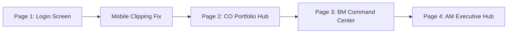

# ICARE Flutter Design System & UI/UX Standard

Authoritative UI/UX design standard for the ICARE Core Banking Flutter platform across Desktop Web, Tablet, and Mobile.

---

## 1. Scope & Strict Presentation-Only Sandbox

> [!CAUTION]
> ### STRICT ZERO-TAMPER INVARIANT: PRESENTATION LAYER ONLY
> To preserve the proven mathematical and operational integrity of the live ICARE core banking platform, all changes made under this skill are strictly confined to the Flutter presentation layer (visual styling, layout composition, widget hierarchy, animation choreography, and tactile feedback).
>
> **The following are 100% IMMUTABLE and LOCKED:**
> 1. **Zero Domain Math Drift**: No alterations to accounting formulas, interest/markup calculation engines (`LoanProductEngine`), principal vs active credit calculations, payoff/excess logic, or cashbook double-entry balancing rules.
> 2. **Zero Backend/API Contract Drift**: No edits to Python services (`services/`), FastAPI route adapters (`api/`), query parameters, request bodies, response schemas, or serialization formats.
> 3. **Zero Database Modifications**: No changes to Supabase PostgreSQL tables, RLS policies, RPC functions, migrations, or database triggers.
> 4. **Zero State Controller Tampering**: Riverpod state providers (e.g. `authControllerProvider`, `authControllerProvider.notifier.login()`), method signatures, error handling pipelines, and route guards remain 100% intact.
> 5. **Financial Source of Truth**: Physical vault cash positions must continue to derive strictly from Account 1000 journal entries in `financial_ledger_entries`.

Redesigned screens must bind to the same approved state providers, callbacks, and commands, preserving their exact loading, error, success, disabled, and retry behaviors.

---

## 2. The 6 Design Pillars

### Pillar 1: Surface Architecture & Hairline Borders
- **Crisp Structural Hairlines**: Replace heavy, dirty drop shadows with institutional 1px hairline borders (`Border.all(color: Color(0xFFE2E8F0), width: 1.0)`).
- **Subtle Layering**: Neutral slate backgrounds (`#F8FAFC`) with pure white elevated cards (`#FFFFFF`), producing clean visual separation.
- **Glassmorphism**: Subtle frosted backdrop filters (`BackdropFilter` with 12px blur) reserved exclusively for hero KPI banners, modals, and login backdrops.

### Pillar 2: Typographic Rhythm & Dual-Mode Text Invariants
- **Vertical Rhythm**: Strict typographic scales based on Inter / System Sans, with generous line heights (1.20–1.45) for effortless legibility.
- **Tabular Figures**: Every numeric display, currency amount, and ledger count **MUST** specify `fontFeatures: [FontFeature.tabularFigures()]` to ensure strict vertical digit alignment.
- **Dual-Mode Text Invariants**:
  1. *Anti-Wrapping Invariant (Financial Numbers)*: Naira amounts (`₦150,000`) and tabular figures must **never wrap character-by-character** across lines. They must remain atomic on a single line (`softWrap: false`, `maxLines: 1`).
  2. *Responsive Wrapping Invariant (Sentences & Banners)*: Every descriptive `Text`, onboarding message, alert callout, and instruction inside a horizontal `Row` **MUST be wrapped in `Expanded` or `Flexible` with `softWrap: true`**. Direct `Text` children in a `Row` are strictly forbidden unless it is a fixed-width short counter or badge.

### Pillar 3: Semantic Color & Status Badge System
- **Deep Forest Emerald Palette**: Brand identity rooted in deep institutional emeralds (`#022C22`, `#064E3B`, `#0F766E`).
- **Semantic Risk Tints**: Success (Emerald `#047857`), Warning (Amber `#B45309`), Danger (Rose `#B91C1C`), and Info (Sapphire `#1D4ED8`), each paired with muted pastel background tints (`50` weight) and hairline border accents.
- **Status Pills**: Pill badges with a $6\text{dp}$ circular dot indicator, clean typography, and zero emojis.

### Pillar 4: Platform-Native Ergonomics (Web, Tablet, Mobile)
- **Desktop Web ($\ge 1024\text{ dp}$)**: Keyboard focus rings, cursor pointers (`SystemMouseCursors.click`), table virtualization, and subtle hover micro-elevations (`InteractiveHoverCard`).
- **Tablet (600–1023 dp)**: Adaptive split-pane master-detail views, centered modal dialogs, and landscape dual-column inspectors.
- **Mobile (< 600 dp)**: Sunlight-readable high-contrast ratios ($\ge 4.5:1$), generous touch targets ($\ge 44 \times 44\text{ dp}$), bottom-sheet inspectors, thumb-zone action bars, and tactile haptic feedback (`HapticFeedback.lightImpact()`, `mediumImpact()`).

### Pillar 5: Motion Choreography & Kinetic Feedback
- **Motion Durations**: Immediate (80ms for press down), Fast (150ms for hovers/fades), Normal (250ms for transitions/morphs), and Slow (400ms for page entrances).
- **Cubic Easing**: Smooth decelerating curves (`Curves.easeOutCubic`, `Curves.easeInOutCubic`) with zero linear transitions.
- **Morphing Submit Buttons**: Submit buttons that compress on touch down (`scale: 0.98`), morph smoothly into an inline circular spinner on submission, transition into a checkmark on success, or trigger a horizontal shake sequence on validation error.

### Pillar 6: Living Loading States & Skeleton Shimmer Waves
- **Zero Blocking Spinners**: Replace opaque full-page loading indicators with continuous gradient shimmer waves (`SkeletonShimmerBox`, `ShimmerSkeletonPage`).
- **Seamless Cross-Fade**: Use `AnimatedSwitcher` to seamlessly transition between shimmer skeletons and loaded data content without abrupt layout jumps.

---

## 3. Modular Reference Guides

Detailed token definitions, reusable widget code blueprints, and financial UX rules are located in the `references/` directory:

1. [**`references/DESIGN_SYSTEM_TOKENS.md`**](file:///c:/Users/DELL/Desktop/Master_%20AY%20Projects/trustmicro-credit/.agents/skills/icare-flutter-design/references/DESIGN_SYSTEM_TOKENS.md): Complete hex codes, typography scales, spatial grid, border radii, shadows, and motion tokens.
2. [**`references/WIDGET_BLUEPRINTS.md`**](file:///c:/Users/DELL/Desktop/Master_%20AY%20Projects/trustmicro-credit/.agents/skills/icare-flutter-design/references/WIDGET_BLUEPRINTS.md): Ready-to-copy Flutter widget blueprints:
   - `NoticeBanner`: Auto-wrapping banner widget guaranteeing zero mobile clipping.
   - `AnimatedSubmitButton`: Morphing button with scale bounce, loading spinner morph, checkmark, and error shake.
   - `SkeletonShimmerPage`: Wave shimmer placeholders for cards, tables, and KPI grids.
   - `InteractiveHoverCard`: Web hover elevation + mobile tactile touch card.
   - `StatusPillBadge`: High-density semantic status pill badge.
3. [**`references/FINANCIAL_UX_PATTERNS.md`**](file:///c:/Users/DELL/Desktop/Master_%20AY%20Projects/trustmicro-credit/.agents/skills/icare-flutter-design/references/FINANCIAL_UX_PATTERNS.md): Core banking patterns, currency formatting, field officer sunlight readability, thumb-zone ergonomics, and double-confirmation modals.

---

## 4. Strict ICARE Corporate Governance Rules

### 1. Strict Zero-Emoji Corporate Governance (Rule 10)
Emojis are **strictly prohibited** across all UI elements (tab headers, buttons, cards, expanders, tables, alerts, dialogs, form controls, or markdown text). Do NOT use emoji characters. Use clean, professional corporate typography or SVG vector / Material Icons instead.

### 2. Strict Zero Internal Identity Leaks in Frontend UI (Rule 12)
Technical rule codes, database identities, and chart-of-accounts internal numbers belong exclusively to backend engines, database migrations, and architectural documentation:
- **Prohibited in UI**: Never show raw rule codes (e.g. `BR-SAV-002`, `BR-SAV-006`, `BR-DASH-005`, `FP-001`), database table/column names (`internal_savings`, `co_cashbooks`), or Chart of Accounts account numbers (`Account 1000`) in user-facing labels, badges, headers, dialogs, helper texts, pill tags, or alert banners.
- **Required in UI**: Use clean, human-friendly corporate banking terminology:
  - Instead of `"Designated Misc Manager (BR-SAV-006)"` $\longrightarrow$ `"Designated Misc Manager"`
  - Instead of `"BR-SAV-002 • BR-SAV-006"` $\longrightarrow$ `"Branch Reserve"` or `"Internal Fund"`
  - Instead of `"Inflows must flow via Account 1000"` $\longrightarrow$ `"All inflows are secured in primary vault cash."`
  - Instead of `"Account 1000 Vault"` $\longrightarrow$ `"Vault Cash (Primary Ledger)"` or `"Branch Vault Cash"`

### 3. Strict Conciseness & Zero Verbosity
Avoid lengthy descriptive paragraphs, wordy tutorial banners, and redundant subheadings. Financial professionals require high-density, low-noise interfaces:
- **Microcopy Over Walls of Text**: Replace multi-line introductory paragraphs with concise, punchy titles and compact status badges.
- **Progressive Tooltips**: Place supplementary explanations, formula notes, or audit hints inside accessible tooltips (`Tooltip`) or contextual helper icons rather than printing paragraphs directly onto the main screen canvas.
- **Short Helper Text**: Field helper copy, subheaders, and card subtitles must remain under 60 characters and focus strictly on operational action.
- **One-Sentence Empty States**: Empty states must consist of exactly 1 clear sentence explaining the current state and 1 clear primary action button.

---

## 5. Page-by-Page Modernization Methodology & Rollout Roadmap

When upgrading the ICARE Flutter application, proceed page by page in strict isolation to prevent regressions and verify presentation fidelity at each stage:

### Page Modernization Protocol:
1. **Contract Audit**: Inspect existing routes, providers, state listeners, and callbacks in the target screen.
2. **Presentation Upgrade**: Refactor layout using the 6 Design Pillars, ensuring all text in horizontal `Row` widgets is wrapped in `Expanded(child: Text(..., softWrap: true))` and all currency values are non-wrapping tabular figures.
3. **Motion & Feedback**: Add staggered entrance animations, morphing submit buttons, and skeleton shimmer loading.
4. **Platform Verification**: Verify desktop web (>1024dp), tablet (600–1023dp), and mobile (<600dp) form factors.
5. **Zero-Tamper Check**: Run `git status -- services/ api/ database/` to confirm zero backend or business logic modification.

---

## 6. Definition of Done / Acceptance Criteria

Accept UI work only when all applicable checks pass:
- Zero backend files, API endpoints, Supabase migrations, or domain calculations were modified.
- All descriptive text in rows wraps properly on mobile screens without horizontal clipping.
- Currency amounts display standard `₦` symbol with thousand separators, tabular figures, and zero line wrapping.
- Loading states utilize smooth skeleton shimmers or inline morphing button spinners instead of blocking dialogs.
- Zero emojis are present anywhere in the UI.
- No internal rule codes (`BR-*`, `Account 1000`) leak into UI labels or banners.
- Flutter static analysis reports zero errors or warnings (`dart analyze`).
