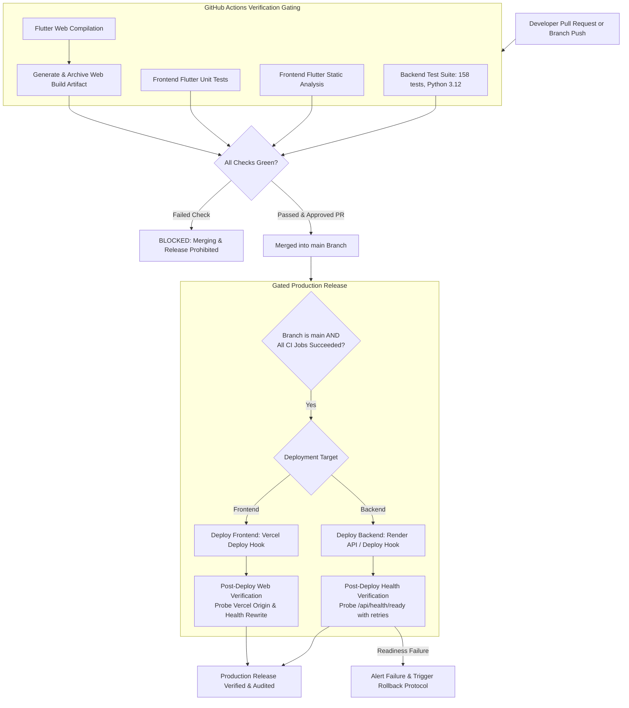

# ICARE Core Banking Platform — Production Deployment & Release Runbook

## 1. Release Architecture & Pipeline Overview

The ICARE Core Banking platform implements a **CI-Gated Production Release Pipeline**. Production deployments are decoupled from raw Git push events and strictly gated behind 100% successful automated test execution in GitHub Actions.



---

## 2. GitHub Repository Configuration & Branch Protection

To prevent untested code from reaching production, enforce GitHub Branch Protection on `main`:

### 2.1 Branch Protection Ruleset (Target: `main`)
1. In the GitHub repository (`MasterAY1/ICARE-app`), navigate to **Settings -> Branches** (or **Rules -> Rulesets**).
2. Click **Add branch protection rule** for branch pattern: `main`.
3. Enable the following controls:
   - **Require a pull request before merging**:
     - Require approvals: minimum **1**.
     - Dismiss stale pull request approvals when new commits are pushed.
   - **Require status checks to pass before merging**:
     - Require branches to be up to date before merging.
     - Add required status checks:
       - `Backend Test Suite (Python 3.12)`
       - `Frontend Flutter Static Analysis & Unit Tests`
       - `Flutter Web Release Compilation & Artifact Packaging`
   - **Require linear history**: Prevent merge commits; use Squash and merge or Rebase.
   - **Do not allow bypassing the above settings**: Enforce rules for repository administrators.

### 2.2 GitHub Repository Secrets Configuration
Navigate to **Settings -> Secrets and variables -> Actions** and configure:

| Secret Name | Purpose | Source Platform | Example Format |
| :--- | :--- | :--- | :--- |
| `RENDER_DEPLOY_HOOK_URL` | Authenticated webhook to trigger Render deployment | Render Dashboard -> `icare-app` Settings | `https://api.render.com/deploy/srv-xxxx?key=yyyy` |
| `VERCEL_DEPLOY_HOOK_URL` | Authenticated webhook to trigger Vercel deployment | Vercel Dashboard -> `icare-banking` Settings | `https://api.vercel.com/v1/integrations/deploy/prj_xxxx/yyyy` |

---

## 3. Render Backend Deployment Decoupling

### 3.1 Disabling Auto-Deploy on Git Push
By default, Render auto-deploys upon any push to `main`. To prevent Render from deploying before CI runs:
1. Log into [Render Dashboard](https://dashboard.render.com).
2. Select the `icare-app` Web Service.
3. In the left navigation, select **Settings**.
4. Scroll to **Build & Deploy**:
   - Change **Auto-Deploy** from `Yes` to **`No`**.
   - Click **Save Changes**.
5. Under **Deploy Hook**:
   - Click **Create Deploy Hook** (or copy existing).
   - Label: `GitHub Actions CI Gated Release`.
   - Branch: `main`.
   - Copy the generated URL and save it as `RENDER_DEPLOY_HOOK_URL` in GitHub Secrets.

### 3.2 Automated Verification Probe
During `deploy-backend`, GitHub Actions queries:
```bash
GET https://icare-app.onrender.com/api/health/ready
```
The probe executes up to 12 attempts with 10-second intervals (total 120s window) to accommodate container startup and cold boots. Deployment succeeds only when the response returns:
```json
{
  "status": "ready",
  "service": "ICARE Core Banking API",
  "ready": true,
  "database": { "status": "connected" }
}
```

---

## 4. Vercel Frontend Release Configuration

### 4.1 Eliminating Committed Binaries
- The Flutter web compilation (`flutter build web --release`) is performed inside GitHub Actions CI.
- The compiled output is archived as an artifact and deployed directly to Vercel via Deploy Hook or CLI.
- `main.dart.js` is no longer required to be committed manually to Git.

### 4.2 Cache Control & Reverse Proxy Rewrites
The authoritative routing and cache behavior is defined in [`vercel.json`](file:///c:/Users/DELL/Desktop/Master_%20AY%20Projects/trustmicro-credit/vercel.json):
- `/health` rewrites to `https://icare-app.onrender.com/health`.
- `/api/(.*)` rewrites to `https://icare-app.onrender.com/api/$1`.
- SPA routing rewrites `/(.*)` to `/index.html`.
- Static asset headers enforce `no-cache, no-store, must-revalidate` for `main.dart.js`, `index.html`, and service workers to guarantee users receive current banking software upon browser reload.

---

## 5. Pre-Deployment Database Backup & Safety Preconditions

Before triggering a release that includes database migrations or high-impact financial changes:

1. **Verify Supabase Backup Availability**:
   - Confirm Point-in-Time Recovery (PITR) status in Supabase Dashboard.
   - For major releases, take a manual database dump:
     ```bash
     supabase db dump -f backup_pre_release_$(date +%Y%m%d).sql
     ```
2. **Review Database Migrations Against Invariants**:
   - Migrations must be non-destructive (`CREATE TABLE IF NOT EXISTS`, `ALTER TABLE ... ADD COLUMN IF NOT EXISTS`).
   - Never drop columns or tables in production without a multi-phase deprecation cycle.
   - All migrations must preserve Account 1000 ledger integrity in `financial_ledger_entries`.

---

## 6. Rollback Procedures & Failure Recovery

### 6.1 Backend API Rollback (Render)
If a deployed backend introduces runtime exceptions or fails post-deploy readiness:

1. **Instant Dashboard Rollback (Fastest)**:
   - In Render Dashboard -> `icare-app` -> **Deploys**.
   - Locate the previous successful deploy.
   - Click the three dots menu -> **Rollback to this deploy**.
2. **CLI / Deploy Hook Rollback**:
   - Call the Render Deploy Hook specifying the previous known good Git commit SHA:
     ```bash
     curl -X POST "${RENDER_DEPLOY_HOOK_URL}&ref=<PREVIOUS_GOOD_COMMIT_SHA>"
     ```

### 6.2 Frontend Web Rollback (Vercel)
If a deployed web frontend introduces client-side regressions:

1. In Vercel Dashboard -> `icare-banking` -> **Deployments**.
2. Select the previous stable deployment.
3. Click **Instant Rollback** (promotes previous deployment to production instantly without rebuild).

### 6.3 Database Rollback Limitations
PostgreSQL DDL migrations cannot always be cleanly reverted automatically:
- If a migration added a column or index: leave it in place (it does not break previous code versions).
- If a data corruption occurred: perform point-in-time recovery (PITR) to the timestamp immediately preceding the release.
- Follow the forward-fix principle for minor schema corrections.

---

## 7. Manual Emergency Release Protocol (`workflow_dispatch`)

In incident conditions requiring urgent patch deployment:
1. Navigate to GitHub Actions -> **ICARE Core Banking Platform CI/CD**.
2. Click **Run workflow**.
3. Select parameters:
   - **Target component to deploy**: `all`, `backend`, or `frontend`.
   - **Emergency override (skip_tests)**: Leave `false` unless backend test runners are degraded.
   - **Reason for release**: Enter mandatory incident ID or ticket reference (e.g. `INC-2026-11-04 Hotfix`).
4. Every emergency execution generates a permanent entry in GitHub Actions audit logs.
